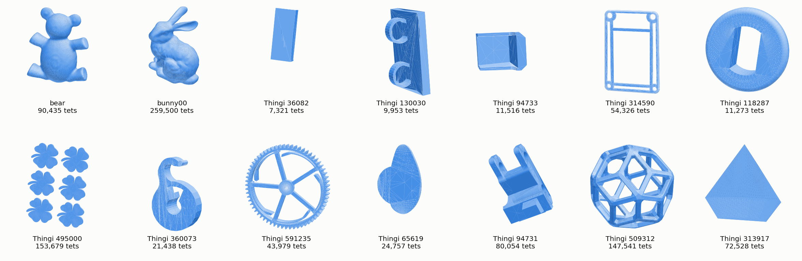
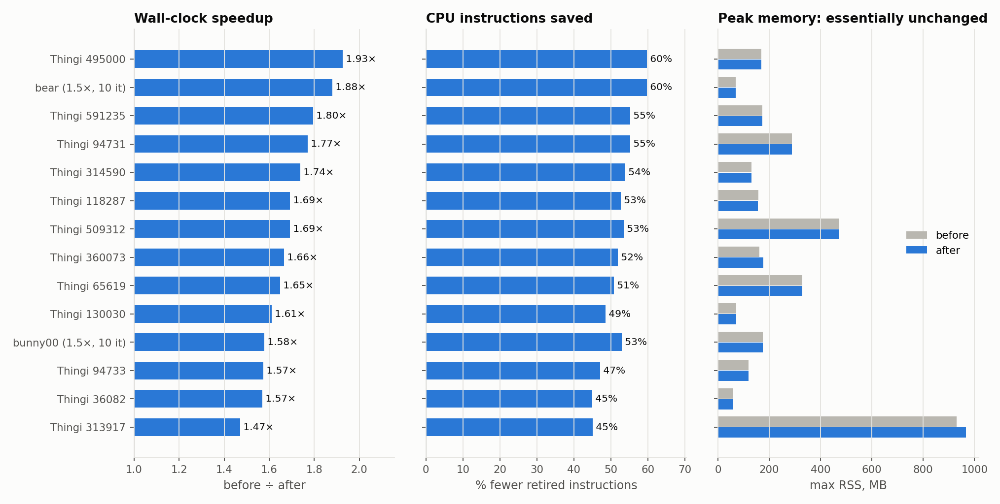
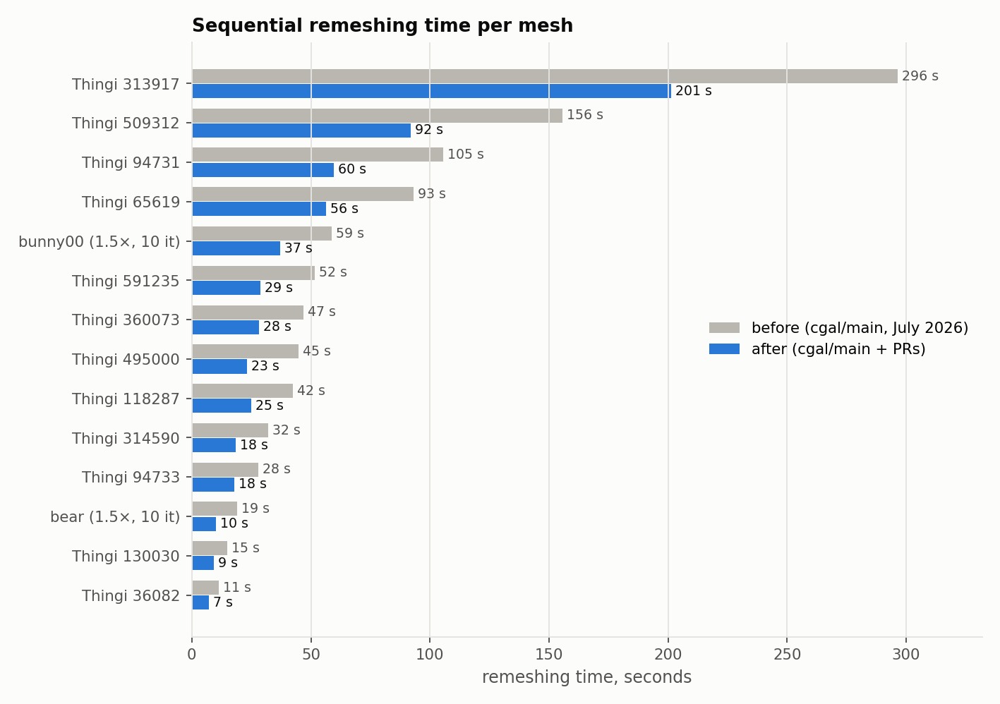
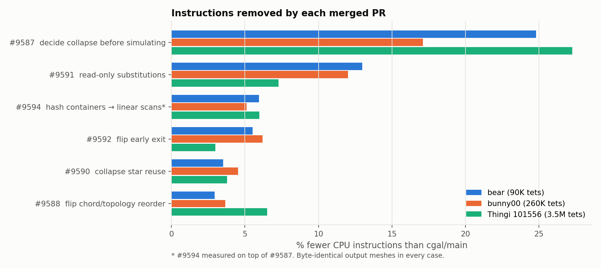
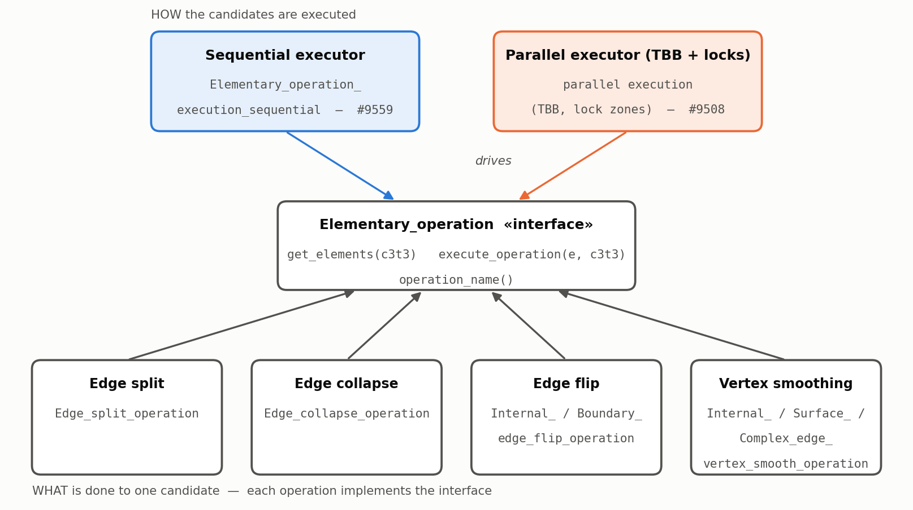
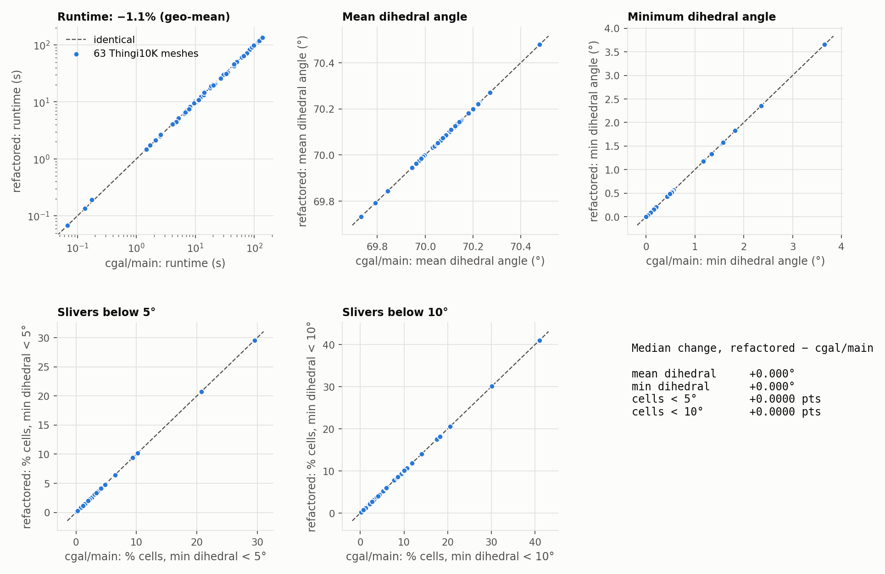
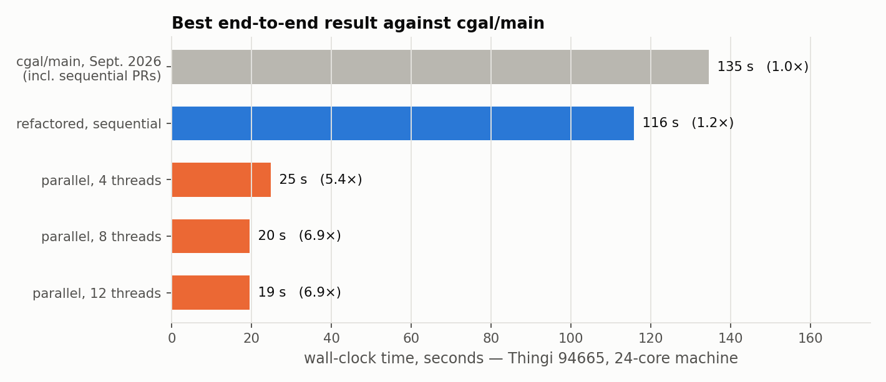
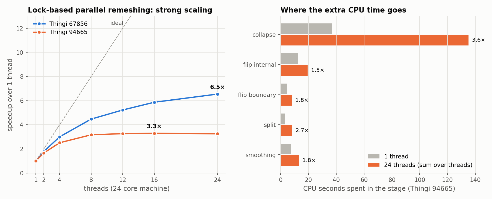
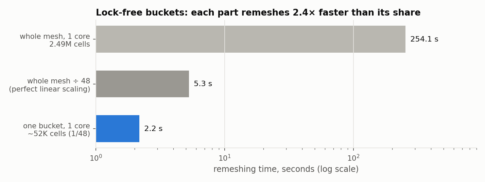

# Parallel Tetrahedral Remeshing using TBB
### Iason Manolas — final report for Google Summer of Code 2026 with the CGAL Project

  
   <em>The meshes used in this report: two CGAL reference meshes and twelve models from the Thingi10K dataset.</em>

# 1. Background

CGAL's [Tetrahedral Remeshing](https://doc.cgal.org/latest/Tetrahedral_remeshing/index.html) package
improves the quality of a multi-material tetrahedral mesh by repeatedly applying four local
operations: **edge split**, **edge collapse**, **edge flip** and **vertex smoothing**. Each pass
removes badly shaped cells and moves the mesh towards a target edge length. Meshes with millions of cells can take many
minutes, or hours, on one CPU core.

GSoC 2025 built a first parallel prototype with Intel TBB. It had three open problems: threads
spent most of their time waiting for each other, the parallel output was of lower quality than the
sequential one, and none of the code had been merged into CGAL. This year's project set out to:

1. make the **sequential** remesher faster, since every parallel strategy runs the same kernels;
2. bring the GSoC 2025 execution framework into a form CGAL can merge, **without changing quality
   or performance**;
3. push the **lock-based parallel** remesher as far as it goes, and understand where it stops;
4. find the strategy that can scale beyond that point.

# 2. Results at a glance

| | |
|---|---|
| **Sequential remeshing, cgal/main** | **1.68× faster** (geometric mean over 14 meshes, up to 1.93×) with **52% fewer CPU instructions**. Output meshes are unchanged wrt original. Seven PRs, all merged. |
| **Refactoring into an execution framework** | **Identical** mesh quality (dihedral angles and sliver fractions) at the same speed. |
| **Lock-based parallel remeshing** | **6.9× faster than the already-optimized cgal/main** end to end, and **6.5×** strong scaling on 24 cores for the best mesh. |
| **Lock-free (domain decomposition)** | The most promising next step. In an experiment by Sébastien Loriot on a corrected version of our bucket split, a 1/48 bucket remeshes in **2.2 s**, against 254 s for the whole mesh. |

### Pull requests

| PR | Title | Status |
|---|---|---|
| [#9567](https://github.com/CGAL/cgal/pull/9567) | Check vertex patches during collapse only if both vertices are not dim 3 | merged |
| [#9587](https://github.com/CGAL/cgal/pull/9587) | Decide a collapse's fate before copying its star | merged |
| [#9588](https://github.com/CGAL/cgal/pull/9588) | Flip chord topology reorder | merged |
| [#9590](https://github.com/CGAL/cgal/pull/9590) | Collapse star reuse | merged |
| [#9591](https://github.com/CGAL/cgal/pull/9591) | Three read-only substitutions for repeated star/point-location queries | merged |
| [#9592](https://github.com/CGAL/cgal/pull/9592) | Give up on a flip as soon as its angles stop improving | merged |
| [#9594](https://github.com/CGAL/cgal/pull/9594) | Replace hash containers with linear scans over small, bounded sets | merged |
| [#9559](https://github.com/CGAL/cgal/pull/9559) | Tetrahedral remeshing sequential refactoring | under review |
| [#9508](https://github.com/CGAL/cgal/pull/9508) | Add parallel execution framework | under review |
| [#9672](https://github.com/CGAL/cgal/pull/9672) | Domain decomposition for parallel tetrahedral remeshing | experimental |

# 3. Sequential optimizations

Any parallel strategy runs the same split, collapse, flip and smooth kernels, so making those
kernels cheaper helps every execution mode. The optimizations came from profiling (Intel VTune, `perf`) and
share one rule: **the output mesh must stay byte-for-byte identical**. Every PR was checked
by diffing its output meshes against `cgal/main` on bear, bunny00, and a 3.5M-cell Thingi10K mesh.
Together they cut the CPU instructions of a remeshing run by about half, and the run time by 1.5–1.9×:

**How this was measured.** *Before* is `cgal/main` just before the first PR arrived
([`3c0119f`](https://github.com/CGAL/cgal/commit/3c0119f92cc)). *After* is `cgal/main` right
after the last one ([`5a0df8a`](https://github.com/CGAL/cgal/commit/5a0df8a8187)). No other commit
between them touches the package. Both were built in Release mode (`-O3`, GCC 13.3) and run on an
Intel i7-1165G7 under Linux. Each mesh ran twice per version in
before/after/after/before order, and the charts show the median. Instructions are the retired-instruction count from `perf stat`. Peak memory is the process's
maximum resident set size (the most physical RAM it held at any time), as reported by GNU `time -v`. The Thingi10K tetrahedral inputs were built from the dataset's repaired
surfaces with `make_conforming_constrained_Delaunay_triangulation_3` (CDT); because a CDT keeps only the surface's vertices, these inputs are coarse, so they are remeshed to
0.25× their average edge length (refinement) with 3 iterations. bear and bunny00 are already fine
meshes, so refining them to 0.25× would create about 6M (bear) and 17M (bunny00) cells. They are run with the settings
of the PR descriptions instead (1.5× the average edge length, i.e. coarsening, and 10 iterations),
and their chart labels say so. The
dihedral-angle statistics of every output are identical before and after. Peak memory is within 1% on 12
of the 14 meshes. On the other two, it is 4% and 9% higher, but this comes from the memory
allocator, not from the PRs. Measuring 360073 at every intermediate commit gives peaks that jump
back and forth between about 166 MB and 181 MB (181, 181, 181, 166, 178, 181, 166), and the
unchanged *before* commit itself measured 166 MB in one build and 181 MB in another.

**Input meshes.**

| Mesh | Vertices | Tetrahedra | Remeshing settings |
|---|---:|---:|---|
| Thingi 36082 | 1,425 | 7,321 | 0.25× edge length, 3 iterations |
| Thingi 130030 | 1,763 | 9,953 | 0.25× edge length, 3 iterations |
| Thingi 118287 | 2,599 | 11,273 | 0.25× edge length, 3 iterations |
| Thingi 94733 | 1,762 | 11,516 | 0.25× edge length, 3 iterations |
| Thingi 360073 | 3,412 | 21,438 | 0.25× edge length, 3 iterations |
| Thingi 65619 | 5,989 | 24,757 | 0.25× edge length, 3 iterations |
| Thingi 591235 | 8,362 | 43,979 | 0.25× edge length, 3 iterations |
| Thingi 314590 | 9,553 | 54,326 | 0.25× edge length, 3 iterations |
| Thingi 313917 | 12,788 | 72,528 | 0.25× edge length, 3 iterations |
| Thingi 94731 | 13,733 | 80,054 | 0.25× edge length, 3 iterations |
| bear | 13,926 | 90,435 | 1.5× edge length, 10 iterations |
| Thingi 509312 | 22,080 | 147,541 | 0.25× edge length, 3 iterations |
| Thingi 495000 | 33,696 | 153,679 | 0.25× edge length, 3 iterations |
| bunny00 | 37,706 | 259,500 | 1.5× edge length, 10 iterations |

Most of the savings come from not doing work whose answer was already known:

- **[#9587](https://github.com/CGAL/cgal/pull/9587) Decide a collapse before simulating it.**
  Every collapse candidate used to be tested by copying its star into a scratch triangulation,
  collapsing it there, and inspecting the result. On bear, 45% of these simulations were rejected
  for one reason only: a dihedral-angle comparison that needs nothing the real mesh does not already
  have. A direct angle test now settles most candidates before any copy is made. It uses a
  `1e-9` margin, so that a rounding difference can never change a verdict. This PR alone removes
  up to 27% of all instructions.
- **[#9591](https://github.com/CGAL/cgal/pull/9591) Read-only substitutions.** A point-location
  query was used only to learn the subdomain of an edge midpoint, which any incident cell already
  stores. A star collection was followed by a scan for its first match, so the scan now runs while
  the star is walked. Repeated sizing-field queries are skipped.
- **[#9594](https://github.com/CGAL/cgal/pull/9594) Hash containers → linear scans.** Sets and maps
  that never hold more than about 20 elements were replaced by inline `small_vector`s. A manifold
  test that counted vertex triples in a hash map now asks the triangulation for neighbours directly.
- **[#9592](https://github.com/CGAL/cgal/pull/9592) Flip early exit.** A flip candidate stops being
  evaluated as soon as its worst angle can no longer beat the current one.
- **[#9590](https://github.com/CGAL/cgal/pull/9590) Collapse star reuse.** The stars of the two
  endpoints of an edge used to be collected up to four times for one collapse. They are now collected
  once. A subdomain count that only needs to know "more than one?" stops at the second value.
- **[#9588](https://github.com/CGAL/cgal/pull/9588) Flip chord/topology reorder.** Cheap checks now
  run before expensive star walks, and a hashed `unordered_set` of flip apices became a small vector.
- **[#9567](https://github.com/CGAL/cgal/pull/9567) Collapse patch check.** This fixed a performance
  regression that [#9531](https://github.com/CGAL/cgal/pull/9531) had introduced: the
  surface-patch lookup now runs only when both endpoints of an edge can lie on a surface.

# 4. Refactoring into an execution framework ([#9559](https://github.com/CGAL/cgal/pull/9559))

In the original code each operation was a free function with its own loop, candidate order and
bookkeeping. This PR expresses all four operations through one small interface: *collect the
candidates*, then *apply the operation to one candidate*. A single executor drives them. This
separates **what** an operation does from **how** the set of operations is executed, in the same way
as the STL's execution policies. A parallel executor then becomes a drop-in replacement
([#9508](https://github.com/CGAL/cgal/pull/9508)).

The refactoring is **behaviour-preserving**. Split, flip, smoothing and collapse make the same
decisions in the same order as before, including the re-queuing of edges that a collapse shortens.
Across **63 Thingi10K meshes** (see below for how they were chosen), the refactored remesher produces the same quality as `cgal/main` on
every metric, including the share of sliver cells, at the same speed:

All 63 meshes give **identical** quality statistics: mean and minimum dihedral angle, and the
fraction of cells with a dihedral angle below 5° and below 10°. Runtime is unchanged
(−1.1%, geometric mean). *Measured on Linux with the PR head
([`d3d83fb`](https://github.com/CGAL/cgal/pull/9559/commits/d3d83fbe5c2)) against its `cgal/main` base
(`aee51ff`), one run per mesh, 3 iterations, target edge length 0.25× the input average. The 100 models were selected at random from the
solid Thingi10K models of CGAL's `thingi10k_max_10k_solid` test list. The 63 used here are those among
the 100 that remesh in under about 4 minutes, which kept this comparison to a few hours on a 4-core
laptop. The excluded 37 are the largest meshes, so the sample is random with respect to shape but
not to size. For the refactoring this makes no difference: its runtime ratio shows no trend with
mesh size. The sequential gains of Section 3, on the other hand, tend to grow with size (rank
correlation 0.58 for the speedup and 0.69 for the instructions saved, over its 12 Thingi10K meshes),
so leaving out the largest meshes understates them rather than inflating them.*

<b>The 63 input meshes</b>: 92 to 411,699 tetrahedra (median 15,546), 30 to 78,631 vertices. Click to expand.

| Thingi ID | Vertices | Tetrahedra |
|---|---:|---:|
| 102041 | 30 | 92 |
| 95489 | 56 | 183 |
| 50112 | 59 | 258 |
| 68248 | 334 | 1,719 |
| 67550 | 371 | 1,722 |
| 131723 | 432 | 2,467 |
| 48224 | 440 | 2,621 |
| 100638 | 606 | 2,929 |
| 186541 | 679 | 3,387 |
| 116063 | 647 | 3,579 |
| 103086 | 680 | 4,016 |
| 203281 | 956 | 4,199 |
| 1036400 | 885 | 4,332 |
| 65609 | 1,431 | 4,662 |
| 1224384 | 769 | 4,749 |
| 103211 | 918 | 5,257 |
| 1582421 | 942 | 5,624 |
| 1439534 | 1,373 | 6,500 |
| 41104 | 1,973 | 6,651 |
| 1120766 | 1,184 | 7,301 |
| 36082 | 1,425 | 7,321 |
| 289662 | 1,931 | 8,097 |
| 113000 | 2,583 | 8,694 |
| 130030 | 1,763 | 9,953 |
| 118287 | 2,599 | 11,273 |
| 94733 | 1,762 | 11,516 |
| 51492 | 2,095 | 11,618 |
| 48421 | 2,606 | 12,811 |
| 1018275 | 4,522 | 14,148 |
| 42652 | 2,614 | 14,958 |
| 65607 | 2,376 | 15,222 |
| 1036396 | 2,830 | 15,546 |
| 343529 | 3,327 | 15,731 |
| 108858 | 3,198 | 20,712 |
| 343546 | 4,509 | 20,729 |
| 500093 | 3,737 | 20,766 |
| 186202 | 4,119 | 20,996 |
| 360073 | 3,412 | 21,438 |
| 124534 | 3,739 | 23,102 |
| 110905 | 4,372 | 24,038 |
| 132447 | 4,211 | 24,071 |
| 65619 | 5,989 | 24,757 |
| 65617 | 5,998 | 24,858 |
| 100323 | 5,266 | 27,886 |
| 360072 | 5,046 | 29,540 |
| 289668 | 6,205 | 29,804 |
| 1036650 | 6,219 | 36,606 |
| 409635 | 7,619 | 38,947 |
| 985159 | 7,082 | 43,723 |
| 591235 | 8,362 | 43,979 |
| 95487 | 7,814 | 46,615 |
| 96073 | 7,387 | 47,269 |
| 314590 | 9,553 | 54,326 |
| 1489599 | 10,413 | 61,506 |
| 99904 | 11,265 | 64,662 |
| 1307397 | 11,014 | 68,079 |
| 94731 | 13,733 | 80,054 |
| 102294 | 14,552 | 86,460 |
| 113221 | 17,402 | 92,654 |
| 40988 | 17,422 | 118,290 |
| 509312 | 22,080 | 147,541 |
| 495000 | 33,696 | 153,679 |
| 113891 | 78,631 | 411,699 |

# 5. Lock-based parallel remeshing ([#9508](https://github.com/CGAL/cgal/pull/9508))

The parallel executor processes the candidates of each operation in parallel with Intel TBB.
Before an operation changes the mesh, it locks the zone of the mesh it will affect. If another thread
already holds part of that zone, the operation is retried later or **deferred** to a short serial
pass at the end. This uses the same locking mechanism as CGAL's parallel Mesh_3, and it is correct
by construction: two threads never modify overlapping zones.

A 24-core machine (Intel Core Ultra 9 285) gave the best end-to-end result:

The baseline here is today's `cgal/main`, which **already contains** the sequential PRs of Section 3.
Against it, the parallel remesher goes from 135 s to **20 s: 6.9× faster**, on top of the 1.7×
from Section 3. The strong-scaling curves show both the best case and the
limit:

On Thingi 67856 the remesher keeps scaling up to **6.5× on 24 threads**. On Thingi 94665 it
flattens at **3.3×** after 8 threads. The instrumented runs show why the lock-based design cannot
go much further:

- **Lock contention grows with the thread count.** At 1 thread no lock attempt fails. At 24 threads
  there are **0.50 failed attempts for every operation** (8.5M retries for 16.9M operations).
- **The retries are paid in CPU time.** Collapse, whose lock zone is the largest (two full vertex
  stars), costs **3.6× more CPU-seconds** at 24 threads than at 1 (135 s against 37 s) for the same
  work. System time rises from 0.3 s to 37 s, which is kernel-side waiting on contended locks.
- **Only 8.8 of 24 cores are ever busy.** Elements that repeatedly fail to lock are deferred to the
  serial tail. For internal flips, that tail takes **3.2 s of the stage's 4.0 s** of wall time, and
  by Amdahl's law it caps the speedup regardless of the number of cores.
- The mesh is **one shared data structure**. Every operation reads and writes cells that neighbour
  other threads' work. Contention is therefore built into the approach.

The lock-based approach could definitely still be improved but would require performance tuning on a machine with high number of cores. These numbers point to the next direction: stop sharing the mesh.

# 6. Future work: lock-free remeshing by domain decomposition

In the lock-free approach, the mesh is **split into parts** and each thread remeshes its own part
**as an independent, small triangulation**, with no locks and no shared state. The cells on the
interfaces between parts are frozen during a round. The interfaces are then moved and the process
repeats, so that the formerly frozen cells are remeshed too. This is the method of
Cirrottola & Froehly, *Parallel unstructured mesh adaptation using iterative remeshing and
repartitioning* ([Inria RR-9307, 2019](https://inria.hal.science/hal-02386837)), which is the basis of
[ParMmg](https://github.com/MmgTools/ParMmg). ParMmg remeshes meshes of more than two billion
elements on 256 cores.

**Why this is promising.** Sébastien Loriot split a 2.49M-cell mesh into 48 buckets and
remeshed each one as its own small triangulation:

A bucket of about 52K cells remeshes in **2.2 s**. Perfect linear scaling of the whole-mesh run
(254 s) would give only 5.3 s per bucket, so each bucket finishes **2.4× faster than its share**.
Small triangulations fit in cache, and a thread that owns its cells never waits for another one.
With 48 cores the remeshing of all buckets would take a few seconds instead of four minutes. This is
a speedup of about 100× before interface handling, far beyond the 3–7× of the lock-based
design. The bucket runs locked the surface facets, so the final figure still has to be measured
end to end.

**Proposed steps**, reusing what #9672 already provides (METIS partitioning, interface freezing
through `is_protected_interface()` in all four operations, partition extraction):

1. **True extraction.** Build each part as a standalone triangulation holding only its own cells
   and a thin halo, as in Sébastien's experiment.
2. **Lock-free parallel remeshing.** Remesh all parts concurrently with the sequential kernels from
   Section 3, with the interfaces and the model surface frozen. Every sequential optimization speeds
   up this step directly.
3. **Interface displacement instead of re-partitioning.** RR-9307 (§4, §7.1) shows that re-running a
   graph partitioner leaves poorly adapted zones along old interfaces, while moving each interface
   a few layers by an **advancing front** does not. It also gives a posteriori corrections for
   disconnected parts (§4.3).
4. **Merge and iterate** for a small number of rounds, until the interface zones reach the quality of
   the interiors.

The execution framework from Sections 4 and 5 is a natural home for this: a *domain-decomposition
executor* next to the sequential and lock-based ones, selected the same way.

# 7. Conclusion

This summer made CGAL's tetrahedral remesher **1.7× faster on a single core** (up to 1.9×), with output
unchanged, through seven merged pull requests. It also turned the GSoC 2025 prototype into a clean
execution framework that keeps quality and performance, and it brought lock-based parallel remeshing
to **6.9× faster than the already-optimized `cgal/main`**. The measurements show why locks on a shared mesh stop scaling,
and point to lock-free domain decomposition as the way forward.

I would like to thank Sébastien Loriot, Mael Rouxel-Labbé and Jane Tournois, for their guidance, their reviews, and for helping shape the direction of this project.
